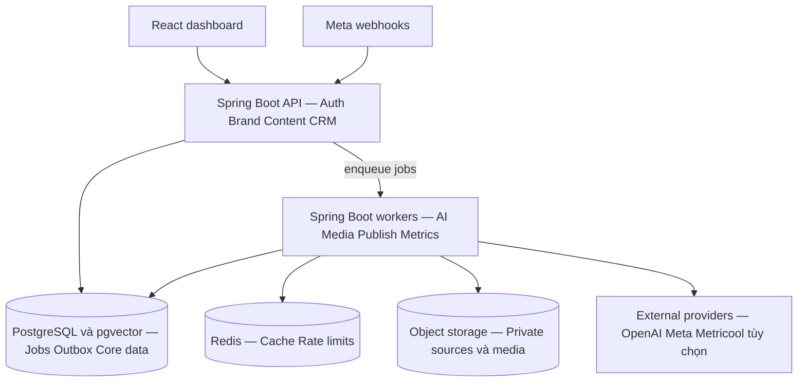
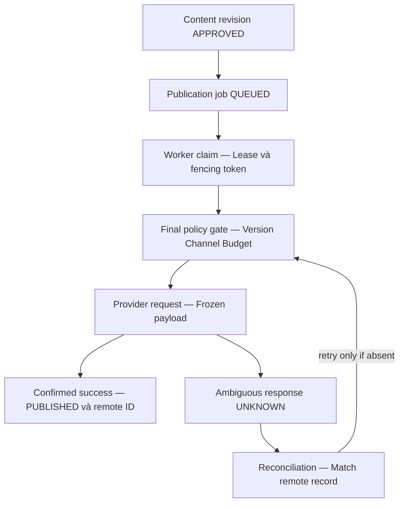

# Kiến trúc hệ thống AI Marketing

*Tự lên ý tưởng tạo nội dung xuất bản và quản lý khách hàng*

Bản thiết kế v1.0 • Ngày 02 tháng 10 năm 2026

### Mục đích tài liệu

Tài liệu này là cơ sở để đội phát triển xây dựng một hệ thống riêng: tiếp nhận kiến thức thương hiệu, tìm và chọn chủ đề, viết bài, tạo hình ảnh, kiểm tra nội dung, lên lịch đăng Facebook Page, thu thập kết quả và quản lý khách hàng quan tâm. Hệ thống vận hành qua API và worker phía máy chủ, không cần người dùng mở giao diện ChatGPT mỗi ngày.

Đề xuất triển khai ban đầu bằng React và TypeScript, Spring Boot với JDK 21, PostgreSQL, Redis và kho tệp tương thích S3. Các module nghiệp vụ nằm trong một codebase; API và worker có thể chạy ở các tiến trình riêng. Facebook Page là kênh đầu tiên; các kênh khác mở rộng qua adapter có kiểm tra năng lực.

### Đối tượng sử dụng

Chủ sản phẩm dùng tài liệu để chốt phạm vi và chế độ tự động. Tech Lead và lập trình viên dùng để chia module, thiết kế dữ liệu, API, worker và hạ tầng. QA và người vận hành dùng các tiêu chí nghiệm thu, kịch bản lỗi và chỉ số giám sát.

### Trạng thái và giới hạn

Đây là bản kiến trúc đề xuất, chưa phải hệ thống đã triển khai. Poip Law được dùng làm tình huống minh họa, không mặc định là thương hiệu duy nhất. Quy mô, ngân sách, thời gian và ngưỡng chấm điểm trong tài liệu là giả định thiết kế cần hiệu chỉnh bằng dữ liệu thật.

Tự động hóa hỗ trợ sản xuất và phân phối nội dung; không bảo đảm tăng trưởng, doanh số hoặc số lead cố định. Tích hợp đăng bài và inbox cần tài khoản, quyền ứng dụng, gói API và điều kiện nền tảng phù hợp.

## Nội dung tài liệu

- [01  Tổng quan sản phẩm và phạm vi](#01-tổng-quan-sản-phẩm-và-phạm-vi)
- [02  Quyết định kiến trúc và công nghệ](#02-quyết-định-kiến-trúc-và-công-nghệ)
- [03  Sơ đồ thành phần và luồng dữ liệu](#03-sơ-đồ-thành-phần-và-luồng-dữ-liệu)
- [04  Ranh giới module và trách nhiệm](#04-ranh-giới-module-và-trách-nhiệm)
- [05  Workflow tự động gồm 18 bước](#05-workflow-tự-động-gồm-18-bước)
- [06  Trạng thái và cơ chế duyệt](#06-trạng-thái-và-cơ-chế-duyệt)
- [07  Kho kiến thức và điều phối AI](#07-kho-kiến-thức-và-điều-phối-ai)
- [08  Hợp đồng dữ liệu và prompt](#08-hợp-đồng-dữ-liệu-và-prompt)
- [09  Tạo ảnh video và quản lý tài sản](#09-tạo-ảnh-video-và-quản-lý-tài-sản)
- [10  Tích hợp Facebook và các nhà cung cấp](#10-tích-hợp-facebook-và-các-nhà-cung-cấp)
- [11  Scheduler và độ tin cậy xuất bản](#11-scheduler-và-độ-tin-cậy-xuất-bản)
- [12  Mô hình dữ liệu nghiệp vụ](#12-mô-hình-dữ-liệu-nghiệp-vụ)
- [13  Dữ liệu vận hành và chiến lược truy vấn](#13-dữ-liệu-vận-hành-và-chiến-lược-truy-vấn)
- [14  API nội bộ và hợp đồng sự kiện](#14-api-nội-bộ-và-hợp-đồng-sự-kiện)
- [15  Bảo mật phân quyền và quyền riêng tư](#15-bảo-mật-phân-quyền-và-quyền-riêng-tư)
- [16  Inbox và quản lý khách hàng](#16-inbox-và-quản-lý-khách-hàng)
- [17  Đo lường và tối ưu nội dung](#17-đo-lường-và-tối-ưu-nội-dung)
- [18  Dashboard và luồng sử dụng](#18-dashboard-và-luồng-sử-dụng)
- [19  Triển khai giám sát và khôi phục](#19-triển-khai-giám-sát-và-khôi-phục)
- [20  Hiệu năng quy mô và kiểm soát chi phí](#20-hiệu-năng-quy-mô-và-kiểm-soát-chi-phí)
- [21  Lộ trình xây dựng và phân rã công việc](#21-lộ-trình-xây-dựng-và-phân-rã-công-việc)
- [22  Nghiệm thu rủi ro và quyết định còn mở](#22-nghiệm-thu-rủi-ro-và-quyết-định-còn-mở)
- [23  Nguồn tham khảo và bàn giao](#23-nguồn-tham-khảo-và-bàn-giao)

Các đề xuất nghiệp vụ và kỹ thuật là quyết định của bản thiết kế. Ký hiệu [S1] đến [S6] dẫn tới tài liệu chính thức ở cuối tài liệu. Thông tin tích hợp được đối chiếu ngày 02 tháng 10 năm 2026; quyền và giới hạn phải được kiểm tra lại trước khi phát hành.

## 01 Tổng quan sản phẩm và phạm vi

### Mục tiêu và vòng lặp vận hành

Người dùng khai báo thương hiệu, đối tượng khách hàng, sản phẩm, giọng văn, nguồn kiến thức, kênh và ngân sách. Hệ thống tạo kế hoạch theo ngày hoặc tuần, sản xuất bản nháp, kiểm tra rồi đưa vào lịch. Sau khi đăng, dữ liệu tương tác và lead quay lại quá trình chọn chủ đề. “Tự học” ở đây là điều chỉnh kế hoạch bằng dữ liệu và thử nghiệm; không tự huấn luyện lại model sau mỗi bài.

| Hạng mục | MVP | Mở rộng |
| --- | --- | --- |
| Thương hiệu | Nhiều brand trong một workspace | Nhiều workspace và gói thuê bao |
| Nội dung | Bài chữ và ảnh Facebook Page | Carousel đa ảnh, Reel, blog và đa kênh |
| AI | Ý tưởng, viết, review và brief ảnh | Research sâu, video và thử nghiệm chiến lược |
| Xuất bản | Một adapter Facebook hoạt động thật | Meta và Metricool cùng giao diện nội bộ |
| Khách hàng | Form landing page, ghi nhận lead, phân công | Inbox webhook và CRM ngoài |
| Phân tích | Kết quả bài đăng và nguồn lead | Phân bổ đóng góp và tối ưu đa kênh |

### Giới hạn phạm vi

Không mặc định đăng lên Facebook cá nhân, tự đăng vào nhóm, lấy danh sách mọi người đã xem bài, tự nhắn tin hàng loạt hay tự chi ngân sách quảng cáo. Dữ liệu nghiên cứu đến từ nguồn công khai được phép sử dụng, kho nội bộ hoặc nhà cung cấp được cấp quyền. Canva, Runway và các kênh khác là lựa chọn mở rộng, không phải điều kiện để MVP hoạt động.

### Người dùng và kết quả cần đạt

- Owner cấu hình mục tiêu, ngân sách, kênh và mức tự động; có thể dừng toàn bộ hoạt động xuất bản.
- Marketer quản lý kế hoạch, bản nháp và hình ảnh; Reviewer kiểm tra nội dung; Publisher quản lý lịch đăng.
- Sales nhận lead, cập nhật trạng thái và ghi nhận khách hàng thành công; Analyst xem dữ liệu theo phạm vi được cấp.

MVP hoàn thành khi một thương hiệu có thể chạy trọn vòng từ kiến thức đến bài đăng thật và lead có nguồn, đồng thời xử lý được các lỗi nền tảng quan trọng.

## 02 Quyết định kiến trúc và công nghệ

### Lựa chọn kiến trúc

Dùng modular monolith để giữ giao dịch nghiệp vụ rõ ràng, tránh chi phí vận hành nhiều dịch vụ ngay từ đầu. Cùng một backend có hai chế độ chạy: API nhận yêu cầu và webhook; worker xử lý công việc dài. API không chờ model viết bài hay media render xong mới trả phản hồi.

| Thành phần | Lựa chọn | Lý do và ranh giới |
| --- | --- | --- |
| Giao diện | React và TypeScript | Dashboard, lịch, editor, inbox, báo cáo |
| Backend | Spring Boot và JDK 21 | REST, security, transaction và worker; chốt phiên bản được hỗ trợ khi khởi tạo [S6] |
| CSDL | PostgreSQL và pgvector | Dữ liệu nghiệp vụ, jobs, outbox; tìm kiếm ngữ nghĩa theo tenant |
| Redis | Cache và rate limit | Không là nơi duy nhất lưu lịch đăng hoặc trạng thái duyệt |
| Tệp | MinIO hoặc dịch vụ S3 | Version, checksum, metadata; media riêng tư mặc định |
| Workflow | Job table và state machine | Lease, retry, heartbeat; đủ cho MVP không cần broker |
| AI | Provider adapter | OpenAI API cho text và media; model ID là cấu hình |
| Xuất bản | Social adapter | Meta trực tiếp ưu tiên; Metricool là tùy chọn theo quyền và gói |

### Khi nào cần nâng cấp

Tách media worker khi CPU hoặc thời gian render ảnh hưởng publish worker. Thêm RabbitMQ hoặc dịch vụ queue khi backlog và số consumer vượt khả năng job table; vẫn giữ PostgreSQL làm nguồn sự thật và outbox làm cầu nối. Cân nhắc workflow engine bền vững khi có nhiều nhánh, chờ người duyệt dài ngày hoặc quy trình chạy nhiều ngày.

Không thêm API Gateway, Kafka hay Kubernetes chỉ để đủ sơ đồ. Reverse proxy hoặc ingress phục vụ TLS và routing là đủ ở giai đoạn đầu. Các thay đổi lớn phải có ADR, đo tải và kế hoạch migration.

## 03 Sơ đồ thành phần và luồng dữ liệu

Sơ đồ dưới thể hiện các container logic. API và worker dùng chung module và schema nhưng có cấu hình tài nguyên, số replica và quyền secret riêng. Các mũi tên mô tả luồng tương tác; không yêu cầu mọi thành phần chạy cùng máy.



### Luồng dữ liệu chính

- Dashboard gọi API bằng phiên đăng nhập. API xác thực workspace, brand và quyền trước khi đọc hoặc thay đổi dữ liệu.
- API ghi nghiệp vụ cùng job hoặc outbox trong một giao dịch. Worker lấy việc đến hạn, đọc phiên bản nguồn và lưu kết quả sau mỗi bước.
- AI chỉ nhận dữ liệu cần cho tác vụ. Tool do backend cho phép; việc đăng bài luôn qua policy gate của Publisher.
- Media đã duyệt được chuyển qua URL hoặc upload phù hợp từng nhà cung cấp. Media riêng tư và hồ sơ khách hàng không đi vào bucket công khai.
- Webhook được xác minh rồi ghi bền vững trước khi trả thành công. Worker chuẩn hóa sự kiện, cập nhật hội thoại, lead hoặc trạng thái đăng.

### Ranh giới tin cậy

Internet, tài liệu tải lên và kết quả model đều là dữ liệu chưa tin cậy. PostgreSQL lưu quyết định nghiệp vụ; secret manager giữ khóa và token. Callback của nhà cung cấp không được tự chọn workspace bằng trường do bên gửi tùy ý nhập.

## 04 Ranh giới module và trách nhiệm

| Module | Dữ liệu sở hữu | Trách nhiệm |
| --- | --- | --- |
| Identity | workspace, membership | Đăng nhập, quyền, phạm vi brand |
| Brand | brand, brand_version, policy | Giọng văn, sản phẩm, giá hiệu lực, mục tiêu |
| Knowledge | document, chunk, source | Import, kiểm tra nguồn, retrieval và version |
| Campaign | campaign, pillar, plan, idea | Tần suất, mục tiêu, lịch dự kiến, phân bổ chủ đề |
| Content | content_item, revision | Bản nháp, biến thể theo kênh, editor và lịch sử |
| AI | prompt_version, ai_run | Model routing, schema, usage và trace |
| Media | asset, asset_version | Sinh ảnh, render template, QA, quyền sử dụng |
| Review | review, approval | Chấm rủi ro, xác minh nguồn và duyệt revision |
| Publishing | publication, attempt | Lịch, payload cố định, gọi provider và đối soát |
| Engagement | conversation, message | Webhook, hộp thư, phân loại và phản hồi |
| Lead | lead, touchpoint, activity | Nguồn, đồng ý, người phụ trách, tiến trình sales |
| Analytics | snapshot, experiment | Chỉ số, thử nghiệm, báo cáo và khuyến nghị |
| Operations | job, outbox, audit, budget | Độ tin cậy, ngân sách, cấu hình và quan sát |

### Quy tắc phụ thuộc

Module trao đổi qua application service hoặc sự kiện nội bộ có version; không sửa trực tiếp bảng của module khác. Publishing đọc snapshot đã duyệt từ Content, Review và Brand để tạo payload. Analytics xuất khuyến nghị; Campaign quyết định có áp dụng trong giới hạn cấu hình.

Agent là vai trò xử lý AI trong workflow, không đồng nghĩa một microservice hoặc một model riêng. Research, Writer, Reviewer và Growth có thể dùng chung provider nhưng phải tách prompt, schema, quyền tool và log.

### Cấu trúc code đề xuất

Mỗi module có domain, application, infrastructure và api. Các adapter Meta, Metricool, OpenAI và S3 nằm ở infrastructure; domain không phụ thuộc SDK bên ngoài. Monorepo gồm backend, frontend và infra; migration SQL chạy theo phiên bản.

## 05 Workflow tự động gồm 18 bước

Workflow được version hóa; mỗi lần chạy ghi workflow_version, brand_version và policy_version. Các bước 01–14 tạo và xuất bản nội dung. Bước 15–18 tạo vòng phản hồi sau khi có dữ liệu; không bắt toàn bộ lần chạy phải chờ đủ 7 ngày mới hoàn thành.

| STT | Xử lý | Đầu ra và điều kiện |
| --- | --- | --- |
| 01 | Kích hoạt theo lịch hoặc yêu cầu | Run ID; không lặp cùng brand và kỳ kế hoạch |
| 02 | Kiểm tra ngân sách và trạng thái brand | Giữ hạn mức; dừng nếu autopilot đã tắt |
| 03 | Nạp kiến thức và policy hiệu lực | Snapshot nguồn, giá, sản phẩm và quy tắc |
| 04 | Research có giới hạn nguồn | Evidence có URL, thời gian và mức tin cậy |
| 05 | Tạo danh sách ý tưởng | Topic, pillar, đối tượng, mục đích và nguồn |
| 06 | Loại trùng và xếp hạng | Ý tưởng đủ khác biệt so với kho bài cũ |
| 07 | Phân bổ nội dung và lịch dự kiến | Plan theo quota brand và khả năng kênh |
| 08 | Writer tạo bản nháp theo kênh | Hook, body, CTA, claims và source_refs |
| 09 | Creative tạo brief và tài sản | Ảnh hoặc template có checksum, version |
| 10 | QA nội dung và media | Schema, link, OCR, brand, sự thật và rủi ro |
| 11 | Sửa có giới hạn hoặc chuyển duyệt | Tối đa hai vòng sửa đề xuất; không lặp vô hạn |
| 12 | Policy quyết định và ghi approval | Gắn người hoặc rule, revision, asset và hạn duyệt |
| 13 | Tạo lịch xuất bản | Publication độc lập theo từng tài khoản và kênh |
| 14 | Preflight và gọi nhà cung cấp | Remote ID hoặc trạng thái lỗi cần đối soát |
| 15 | Lấy metrics và nhận webhook | Snapshot có freshness, hội thoại chuẩn hóa |
| 16 | Ghi nhận và phân công lead | Touchpoint, consent, owner và trạng thái |
| 17 | Đánh giá nội dung và thử nghiệm | Chỉ số theo mục tiêu, cohort và tuổi bài |
| 18 | Đề xuất kế hoạch kỳ tiếp theo | Plan version mới; không tự sửa brand policy |

Thời điểm 06 giờ tạo nội dung hoặc 20 giờ đăng chỉ là cấu hình minh họa. Job lưu UTC và múi giờ IANA của brand; giao diện hiển thị Asia/Ho_Chi_Minh cho thương hiệu tại Việt Nam.

## 06 Trạng thái và cơ chế duyệt

### Tách trạng thái nội dung và trạng thái xuất bản

Content revision đi từ DRAFT đến IN_REVIEW, rồi APPROVED hoặc CHANGES_REQUESTED. Khi cần sửa, tạo revision mới để duyệt lại; revision không còn sử dụng có thể ARCHIVED. Publication có vòng đời riêng vì một revision có thể đăng lên nhiều tài khoản, mỗi tài khoản thành công hoặc lỗi khác nhau.

| Publication | Ý nghĩa | Hành động tiếp |
| --- | --- | --- |
| QUEUED | Đã chốt revision, lịch và provider | Chờ đến hạn và claim job |
| DISPATCHING | Worker đang gửi hoặc tạo lịch ngoài | Ghi attempt; giới hạn lease |
| REMOTE_SCHEDULED | Provider xác nhận nhận lịch | Đối soát đến khi bài thật được đăng |
| PUBLISHED | Xác nhận remote post ID | Bắt đầu đo lường |
| RETRY_WAIT | Lỗi chắc chắn có thể retry | Chờ backoff và deadline |
| UNKNOWN | Không biết provider đã nhận hay chưa | Đối soát; cấm gửi lại mù quáng |
| BLOCKED | Token, policy hoặc quyền không đạt | Người dùng xử lý rồi preflight lại |
| FAILED hoặc CANCELLED | Lỗi cuối hoặc đã hủy được xác nhận | Giữ lịch sử; tạo thao tác mới nếu cần |

### Ba chế độ tự động

- ASSISTED: AI tạo nội dung; người dùng duyệt từng revision trước khi lập lịch.
- RULED_AUTOPILOT: tự duyệt chỉ khi đạt tất cả rule, có nguồn hợp lệ, media đạt QA và còn hạn mức. Bài có giá, ưu đãi, cam kết hoặc nhận định pháp lý chuyển hàng đợi duyệt theo brand policy.
- CAMPAIGN_AUTOPILOT: người dùng duyệt khung chiến dịch, nguồn và mẫu được phép; AI tạo biến thể trong khung. Thay đổi ngoài phạm vi phải duyệt lại.

### Bất biến duyệt và hủy

Approval gắn revision ID, asset version, brand policy version, người hoặc rule duyệt và thời hạn. Thay body, CTA, giá, ảnh hoặc tài khoản đích làm mất hiệu lực phần duyệt tương ứng. Nút dừng chặn job mới và preflight; lịch đã gửi sang provider phải hủy riêng và đối soát. Không thông báo “đã hủy” khi nhà cung cấp chưa xác nhận.

## 07 Kho kiến thức và điều phối AI

### Brand Memory có nguồn và phiên bản

Kho kiến thức lưu mô tả dịch vụ, biểu phí có thời hạn, FAQ, khách hàng mục tiêu, giọng văn, case được phép công khai và danh mục claim bị cấm. Mỗi tài liệu có owner, nguồn, ngày hiệu lực, mức riêng tư và trạng thái duyệt. Import không đồng nghĩa được phép dùng để đăng.

Pipeline import gồm kiểm tra tệp, trích xuất hoặc OCR, chia chunk theo cấu trúc, gắn metadata, tạo embedding và lập chỉ mục. Thay tài liệu tạo version mới; version cũ vẫn phục vụ truy vết. Với nguồn cập nhật thường xuyên, stale_after là cấu hình; giá dùng khoảng hiệu lực thay vì chỉ dựa ngày tải lên.

### Retrieval trước khi viết

- Lọc workspace_id, brand_id, ACL, trạng thái duyệt và hiệu lực trước khi xếp hạng. Kết hợp tìm kiếm từ khóa và vector; không cho truy vấn vượt tenant.
- Trả evidence bundle gồm chunk ID, document version, URL hoặc vị trí trang, thời điểm truy cập và claim có thể sử dụng.
- Khi thiếu nguồn cho một claim quan trọng, yêu cầu nguồn hoặc chuyển duyệt. Không lấy điểm tự tin của model làm bằng chứng.

### Điều phối model và tool

Backend chọn model theo loại việc, latency, chất lượng kiểm thử và giá cấu hình. Classification và rewrite đơn giản có thể dùng model ít tốn hơn; quyết định phức tạp dùng model phù hợp hơn. Provider adapter chuẩn hóa usage, lỗi, timeout và ID request. Model và giá không đóng cứng trong code.

Dùng Structured Outputs cho JSON theo schema được hỗ trợ; dùng function calling cho tool có kiểm soát [S1]. Schema đúng không bảo đảm nội dung đúng. Tool research chỉ đọc nguồn; writer không có quyền publish. Backend kiểm tra mọi tham số trước khi thực thi tool.

### Ngăn tài liệu điều khiển workflow

Nội dung website, comment và tài liệu được đặt trong vùng dữ liệu chưa tin cậy. Chỉ system policy và quyền backend quyết định hành động. Model không được truy cập token, SQL tùy ý hoặc URL nội bộ. Log lưu output và trace cần thiết, không yêu cầu model cung cấp chuỗi suy luận riêng tư.

## 08 Hợp đồng dữ liệu và prompt

### Hợp đồng output bản nháp

JSON sau là schema nghiệp vụ rút gọn, không phải payload của nhà cung cấp. Backend triển khai JSON Schema với required, enum, giới hạn độ dài và additionalProperties=false. Claim và nguồn phải đối chiếu với evidence bundle của lần chạy.

```json
{
  "schema_version": "1.0",
  "idea_id": "idea_example",
  "channel": "FACEBOOK_PAGE",
  "purpose": "EDUCATION",
  "hook": "Tên doanh nghiệp có bảo vệ tên thương hiệu không?",
  "body": "Nội dung dựa trên nguồn đã được kiểm tra...",
  "cta": "Gửi nhu cầu để được tư vấn phù hợp",
  "claims": [{"text": "...", "source_refs": ["chunk_01"]}],
  "creative_brief": {"template": "FAQ", "text": "..."},
  "risk_flags": ["LEGAL_CONTENT"],
  "suggested_slot": "EVENING"
}
```

### Prompt theo vai trò

| Vai trò | Input bắt buộc | Yêu cầu output |
| --- | --- | --- |
| Research | Phạm vi nguồn, câu hỏi, freshness | Evidence; tách fact và suy đoán |
| Strategist | Pillars, mục tiêu, lịch cũ, dữ liệu | Ý tưởng, lý do, diversity và slot |
| Writer | Evidence, brand version, format | JSON bản nháp; không tự tạo số liệu hoặc case |
| Reviewer | Draft, evidence, claim rules | PASS, REVISE hoặc HUMAN_REVIEW; lỗi và nguồn |
| Creative | Bản nháp, template, asset library | Brief, layout và danh sách chữ cần render |
| Growth | Metrics đầy đủ, cohort, mục tiêu | Khuyến nghị và giả thuyết thử nghiệm |

### Version và kiểm thử prompt

Prompt registry lưu version bất biến, hash, model config, schema version, ngày kích hoạt và kết quả eval. Mỗi ai_run lưu phiên bản input, evidence refs, output, token, chi phí và lỗi. Thay prompt cần chạy bộ tình huống tiếng Việt: nguồn thiếu, giá hết hạn, dữ liệu mâu thuẫn, prompt injection và case có thông tin khách hàng.

Prompt skeleton gồm vai trò, mục tiêu, ràng buộc, nguồn được cấp, nội dung yêu cầu và schema. Nêu rõ không bịa kết quả, không tự đổi giá, không sao chép nguyên bài đối thủ và trả HUMAN_REVIEW khi thiếu căn cứ cho claim cần kiểm tra.

## 09 Tạo ảnh video và quản lý tài sản

### Pipeline media có thể kiểm tra

Creative Agent tạo brief; media worker tạo nền hoặc ảnh, rồi render chữ bằng template. Template SVG hoặc HTML giúp giữ logo, màu và chữ tiếng Việt đúng. Hình tạo bằng AI vẫn phải kiểm tra lỗi chữ, chi tiết và quyền sử dụng trước khi xuất bản.

- Asset gốc và asset xuất bản có version riêng; lưu hash, kích thước, MIME, tỷ lệ ảnh, prompt hoặc template version, quyền sử dụng và provenance.
- QA kiểm tra decode tệp, kích thước, dung lượng, vùng chữ an toàn, OCR so với nội dung yêu cầu, logo và hình nhạy cảm.
- Creative bị lỗi có thể dùng template đã duyệt; không tự lấy ảnh bất kỳ trên Internet làm fallback.

### Khả năng tích hợp

MVP dùng template nội bộ và adapter tạo ảnh. Canva chỉ bật khi đã xác minh API, quyền tài khoản và thao tác cần dùng; không giả định mọi tính năng UI có API. Video có pipeline riêng: kịch bản, tài sản, giọng đọc nếu có quyền, render, subtitle, QA và chờ xử lý của nền tảng. Runway hoặc provider khác chỉ bổ sung khi kiểm chứng được API và chi phí.

### Kho tệp và đường dẫn giao cho provider

Bucket nguồn riêng tư; API cấp quyền tải lên ngắn hạn và kiểm tra checksum sau upload. Asset xuất bản có đường dẫn riêng, chỉ chứa tài sản đã duyệt. Meta và Metricool có cách lấy media khác nhau; adapter tự kiểm tra khả năng tải media trước khi gửi lịch.

Theo hướng dẫn Metricool, media URL cần công khai và không hết hạn, sau đó normalize và gắn mediaId [S4]. Vì vậy adapter Metricool không dùng URL ký ngắn hạn làm nguồn lịch đăng. Giữ bản media công khai đến khi provider đã lấy xong và hoàn tất đối soát; không công khai hồ sơ hoặc tài liệu nội bộ.

### Hủy và dọn tài sản

Không xóa asset đang được publication hoặc provider schedule tham chiếu. Dọn tệp mồ côi theo lifecycle sau thời gian giữ cấu hình. Thu hồi URL do lộ dữ liệu phải đánh dấu BLOCKED và hủy các lịch liên quan trước khi tạo asset thay thế.

## 10 Tích hợp Facebook và các nhà cung cấp

### Giao diện adapter chung

```text
SocialPublisher.capabilities(account)
SocialPublisher.validate(snapshot)
SocialPublisher.publish(snapshot, operationKey)
SocialPublisher.schedule(snapshot, operationKey)  // optional
SocialPublisher.cancel(remoteScheduleId)
SocialPublisher.reconcile(operation)
SocialPublisher.fetchMetrics(remotePostId, window)
```

Capabilities lưu dạng bài, media, lịch ngoài, hủy, edit, analytics và inbox có hỗ trợ. Giao diện ẩn lựa chọn chưa được adapter hoặc tài khoản hỗ trợ. Một publication chỉ chọn một provider để đăng lên một tài khoản; không đồng thời gửi cùng nội dung qua Meta và Metricool.

| Tích hợp | Điều kiện | Quy tắc triển khai |
| --- | --- | --- |
| Meta Page | Page token và quyền phù hợp | Kiểm tra pages_manage_posts, pages_read_engagement và quyền liên quan [S2] |
| Meta webhook | App subscription và HTTPS | Xác minh challenge, chữ ký và nhận event được cấp [S3] |
| Messenger | Quyền messaging và policy hiện hành | Đánh giá cửa sổ phản hồi tại thời điểm gửi [S5] |
| Metricool | Gói có API và brand đã kết nối | Hiện hướng dẫn nêu Advanced hoặc Custom [S4] |
| Kênh khác | API, account type và quyền riêng | Bật sau capability spike; không kế thừa quyền Facebook |

### Kết nối và vòng đời token

OAuth callback kiểm tra state, danh tính người kết nối và workspace. Lưu remote account ID, phạm vi quyền, metadata hạn token nếu có, health và tham chiếu secret mã hóa. Kiểm tra quyền khi kết nối và trước xuất bản; token có thể bị thu hồi dù chưa đến hạn. Không giả định token luôn refresh được tự động.

Khi mất quyền, chuyển CONNECTION_ACTION_REQUIRED, chặn job và hướng dẫn kết nối lại. Thay Graph API version cần contract test và kiểm tra deprecation. App Review, Business Verification và mức truy cập là dependency cần xác nhận theo use case; không cam kết được Meta duyệt.

### Lịch ngoài và lịch nội bộ

Meta trực tiếp có thể dùng scheduler nội bộ cho MVP. Metricool tạo remote schedule trước giờ đăng; response tạo lịch chưa chứng minh bài đã lên mạng. Đồng bộ remote schedule ID và theo dõi đến trạng thái xuất bản cuối cùng.

## 11 Scheduler và độ tin cậy xuất bản



### Claim job và chống đăng trùng

Worker claim job đến hạn bằng giao dịch ngắn và SELECT FOR UPDATE SKIP LOCKED; ghi lease_until, owner và fencing token, rồi commit trước khi gọi mạng. Heartbeat gia hạn lease. Worker cũ mất lease không được ghi kết quả lên trạng thái mới; trạng thái DISPATCHING quá hạn chuyển đối soát thay vì tự gửi lại.

Unique key gồm workspace, revision, account và publication intent. Tạo lịch qua API có Idempotency-Key; lưu hash request để phát hiện cùng khóa nhưng payload khác. Attempt có operation key ổn định để dùng nếu provider hỗ trợ. Khóa trong CSDL chỉ ngăn trùng nội bộ; không tạo bảo đảm exactly-once ở API bên ngoài.

### Retry và kết quả không xác định

429 tuân thủ Retry-After khi có; lỗi tạm thời dùng exponential backoff có jitter. Lỗi quyền, schema hoặc media chuyển BLOCKED hoặc FAILED. Timeout sau khi gửi có thể đã đăng thành công: ghi UNKNOWN, tìm remote record bằng bằng chứng đủ mạnh; thiếu căn cứ thì chuyển người vận hành. Không dùng riêng text hoặc giờ gần nhau để kết luận chắc chắn trùng bài.

### Gate cuối và thời hạn

Ngay trước gọi provider kiểm tra brand enabled, approval còn hiệu lực, revision hash, media, token, quota và giờ đăng. Quá deadline thì bỏ slot hoặc yêu cầu dời lịch theo policy; không đăng dồn backlog. Với remote schedule, thay đổi policy phải gửi hủy hoặc cập nhật ngoài và xác minh kết quả.

## 12 Mô hình dữ liệu nghiệp vụ

### Quan hệ dữ liệu cốt lõi

Workspace có nhiều membership và brand. Brand có campaign, nguồn kiến thức và social account. Campaign có pillar, idea và plan. Content item có nhiều revision bất biến; mỗi revision có các asset version, review và approval. Publication tham chiếu một revision, một account và một provider. Một bài gốc có thể có nhiều publication theo kênh.

| Bảng | Trường chính cần có | Quan hệ hoặc bất biến |
| --- | --- | --- |
| workspace / membership | id, user_id, role, status | Thành viên chỉ đọc brand được cấp |
| brand / brand_version | workspace_id, version, config_json | Config có lịch sử, hiệu lực và hash |
| campaign / pillar / idea | brand_id, objective, status, source_refs | Idea gắn nguồn và fingerprint |
| content_item | brand_id, campaign_id, purpose | Không lưu đè bản đã duyệt |
| content_revision | content_id, revision_no, body, claims | Unique content_id và revision_no |
| revision_asset | revision_id, asset_version_id, position | Giữ thứ tự ảnh và version cụ thể |
| review / approval | revision_id, policy_version, decision | Approval có validity và snapshot hash |
| social_account | brand_id, remote_id, provider, health | Token chỉ lưu secret reference |
| publication | revision_id, account_id, due_at, status | Unique intent; lưu remote ID nếu có |
| publication_attempt | publication_id, attempt_no, outcome | Audit request đã che token và response ID |

### Ràng buộc tenant và phiên bản

Các bảng nghiệp vụ có workspace_id và brand_id khi cần. Composite foreign key kèm workspace_id ngăn tham chiếu chéo workspace. Approval không được trỏ revision ở brand khác. API dùng optimistic locking cho cấu hình, kế hoạch và thao tác lịch; xung đột trả 409 với version hiện tại.

### Dữ liệu thời gian và tiền

Lịch lưu timestamptz theo UTC và timezone của brand. Ngân sách có currency; giá tiền dùng decimal hoặc đơn vị nhỏ nhất theo currency, không dùng float. Dữ liệu bổ sung linh hoạt dùng JSONB, nhưng trạng thái, ngày đến hạn và trường lọc quan trọng là cột có index.

## 13 Dữ liệu vận hành và chiến lược truy vấn

| Nhóm bảng | Dữ liệu | Index hoặc constraint cần có |
| --- | --- | --- |
| knowledge_document / version | source, approval, effective range | workspace + brand + status + hiệu lực |
| knowledge_chunk | text, source locator, embedding | Tenant filter, text search; vector index khi đủ tải |
| asset / asset_version | checksum, MIME, rights, storage key | workspace + checksum; asset + version |
| workflow_run / step_run | workflow version, input hash, status | run + step + iteration unique |
| job | kind, due_at, status, lease, attempts | Partial index theo due_at cho READY |
| outbox / inbox_event | event ID, payload, schema version | event ID unique; index chưa xử lý |
| prompt_version / ai_run | model, tokens, usage, input refs | brand + created_at; run + step |
| conversation / message | account, remote thread và message ID | account + remote message ID unique |
| lead / touchpoint / activity | contact, nguồn, consent, owner | brand + status + created_at + id |
| metric_snapshot | publication, metric, window, fetched_at | publication + metric + window unique |
| experiment / assignment | hypothesis, variant, cohort | assignment duy nhất theo publication |
| budget_ledger / audit_log | reserve, settle, actor, action | brand + kỳ ngân sách; trace ID |

### Pagination và tìm kiếm

Danh sách lớn dùng keyset pagination theo created_at và id, với cursor có chữ ký và limit tối đa 100 đề xuất. Filter luôn bắt đầu bằng workspace và brand. Tránh OFFSET sâu, N+1 và truy vấn toàn bộ body hoặc media cho màn danh sách. Export lớn chạy job và lưu tệp riêng có thời hạn.

### Tăng trưởng và lưu trữ

Partition metric_snapshot, ai_run hoặc audit theo tháng khi kích thước và truy vấn chứng minh có lợi. Giữ tổng hợp ngày để dashboard không quét toàn bộ event. Embedding model đổi version phải reindex theo đợt; không trộn vector khác số chiều hoặc model trong cùng không gian so sánh.

Retention ban đầu đề xuất: log kỹ thuật 30 ngày, raw webhook đã chuẩn hóa 30 ngày, AI output 90 ngày; hồ sơ lead theo chính sách doanh nghiệp. Đây là cấu hình sản phẩm cần chốt, không phải khẳng định thời hạn pháp luật. Xóa khách hàng lan tới search index, tệp và provider theo khả năng; backup có thời hạn và tombstone khi phục hồi.

## 14 API nội bộ và hợp đồng sự kiện

### REST API phục vụ giao diện

| API nội bộ đề xuất | Kết quả | Quy tắc |
| --- | --- | --- |
| POST /v1/brands | Tạo brand | Owner hoặc Admin; không nhận workspace tùy ý |
| POST /v1/brands/{id}/knowledge-imports | 202 và job_id | Kiểm tra quyền tệp, MIME, dung lượng |
| POST /v1/campaigns/{id}/runs | 202 và run_id | Idempotency-Key; giữ ngân sách |
| GET /v1/runs/{id} | Tiến độ và lỗi | Không trả secret hoặc nội dung riêng trái quyền |
| POST /v1/contents/{id}/revisions | Revision mới | Không sửa revision đã duyệt |
| POST /v1/revisions/{id}/approvals | Quyết định review | Expected version và approval scope |
| POST /v1/publications | 202 và publication_id | Approval hash, intent và thời gian hợp lệ |
| POST /v1/publications/{id}/cancel | Yêu cầu hủy | Trạng thái chờ xác nhận nếu lịch ở provider |
| GET /v1/calendar và /v1/leads | Trang dữ liệu | Cursor, khoảng thời gian, brand filter |
| POST /v1/brands/{id}/pause | Chặn hoạt động mới | Audit; tạo job hủy lịch ngoài nếu được chọn |

### Envelope sự kiện

```json
{
  "event_id": "uuid", "schema_version": 1,
  "type": "PublicationConfirmed",
  "workspace_id": "uuid", "brand_id": "uuid",
  "aggregate_id": "publication_uuid", "aggregate_version": 4,
  "occurred_at": "2026-10-02T13:00:00Z",
  "trace_id": "uuid", "payload": {"remote_post_id": "..."}
}
```

Ghi outbox cùng giao dịch đổi trạng thái. Dispatcher có thể giao lặp; consumer ghi inbox_event và thay nghiệp vụ cùng giao dịch để xử lý idempotent. Event chứa ID và metadata tối thiểu; dữ liệu riêng chỉ tải lại qua service có quyền. Consumer dùng aggregate_version để tránh event cũ ghi đè trạng thái mới.

Các sự kiện chính gồm KnowledgeIndexed, DraftCreated, ApprovalGranted, PublicationQueued, PublicationConfirmed, PublicationBlocked, LeadCaptured và MetricsRefreshed. REST lỗi có code, message, trace_id và retryable; không lộ stack trace. OpenAPI là hợp đồng version hóa của API nội bộ.

## 15 Bảo mật phân quyền và quyền riêng tư

### Phân quyền theo workspace và brand

| Quyền | Owner Admin | Marketer | Reviewer | Sales | Analyst |
| --- | --- | --- | --- | --- | --- |
| Brand và kết nối | Có | Đọc cấu hình | Đọc | Đọc cần thiết | Đọc |
| Viết và sửa draft | Có | Có | Góp ý | Không | Không |
| Duyệt nội dung | Có | Theo cấp quyền | Có | Không | Không |
| Xuất bản và hủy lịch | Có | Theo cấp quyền | Không mặc định | Không | Không |
| Lead và contact | Có | Theo cấp quyền | Không mặc định | Có theo phân công | Ẩn contact |
| Secret và ngân sách | Có theo vai trò | Không | Không | Không | Chỉ tổng hợp |

Vai trò Publisher có thể cấp riêng; không bắt Marketer phải được đăng bài. Với thương hiệu rủi ro cao, người sửa cuối không tự duyệt. Kiểm tra quyền ở backend, không chỉ ẩn nút frontend. Khi thành viên bị thu hồi quyền, phiên và job đại diện họ phải được đánh giá lại theo policy.

Đăng nhập qua OIDC với nhà cung cấp danh tính được chọn. Ưu tiên session cookie HttpOnly, Secure và SameSite phù hợp; bật CSRF cho thao tác ghi dùng cookie. Token của nhà cung cấp xã hội không đi vào localStorage. Phiên có hạn, logout thu hồi session và Owner có MFA theo khả năng hệ thống danh tính.

### Secret và webhook

- Khóa AI và social token nằm trong secret manager hoặc được mã hóa bằng khóa tách khỏi CSDL; frontend chỉ thấy health và quyền đã cấp.
- Xác minh chữ ký webhook trên raw body bằng secret phù hợp; so sánh constant-time. Deduplicate bằng remote event ID hoặc hash có phạm vi, không tin workspace_id trong payload.
- ACK sau khi event được ghi bền vững; xử lý AI ở worker. Giới hạn kích thước body, request rate và loại event được nhận.

### Tệp nguồn và công cụ truy cập mạng

Quét tệp, kiểm tra MIME thực, giới hạn dung lượng và tránh thực thi macro. Fetch URL chặn mạng nội bộ, metadata endpoint, loopback và redirect tới vùng bị cấm để giảm SSRF. Không cấp network tool tổng quát cho Writer. Nội dung đối thủ chỉ là tín hiệu nghiên cứu, không là nguồn để sao chép bài.

### Quyền riêng tư và audit

Thu thập contact khi khách chủ động cung cấp hoặc theo cơ chế được cấp quyền; lưu purpose và consent khi cần. Không đưa nguyên inbox vào prompt nếu chỉ cần phân loại; che hoặc giảm dữ liệu nhận dạng. Audit ai duyệt, sửa policy, kết nối kênh, export lead và kích hoạt autopilot. Nghĩa vụ pháp lý cụ thể cần được rà soát theo thị trường triển khai.

## 16 Inbox và quản lý khách hàng

### Luồng nhận và trả lời

Meta webhook vào inbox_event; worker xác định account đã kết nối, lưu hội thoại và message có remote ID. Bộ rule và AI phân loại câu hỏi dịch vụ, yêu cầu giá, lead, khiếu nại hoặc spam. Hệ thống chọn trả lời mẫu có nguồn, tạo bản nháp để người duyệt hoặc chuyển Sales. Lưu ID reply để tránh phản hồi lặp.

Một conversation chỉ có một chủ thể xử lý tại thời điểm gửi. Khi người thật nhận hội thoại, bot chuyển HUMAN_HANDOFF và dừng tự gửi; nhận diện echo từ chính Page để tránh vòng lặp. Policy gate kiểm tra permission, consent nếu áp dụng và messaging window tại thời điểm gửi [S5]. Không cố gửi lại khi cửa sổ đã đóng.

### Lead và nguồn khách hàng

| Trường | Ý nghĩa | Nguồn hợp lệ |
| --- | --- | --- |
| brand_id và account_id | Phạm vi sở hữu | Mapping kết nối nội bộ |
| contact | Thông tin liên hệ tối thiểu | Form hoặc khách chủ động cung cấp |
| interest và stage | Nhu cầu và tiến trình | Phân loại được xác nhận hoặc Sales |
| source_publication_id | Nguồn bài có căn cứ | UTM, referral hoặc event liên quan |
| attribution_confidence | Độ chắc chắn của nguồn | EXACT, INFERRED hoặc UNKNOWN |
| purpose và consent | Mục đích sử dụng contact | Thời gian, biểu mẫu hoặc bản policy |
| assigned_user và next_action | Người chăm sóc và bước tiếp | Rule phân công hoặc thao tác Sales |

### Trạng thái và chống trùng lead

NEW → QUALIFIED → CONTACTED → WON hoặc LOST; có DISQUALIFIED và opt-out. Trùng contact chỉ gợi ý merge trong cùng brand theo policy, không tự gộp người qua tên hiển thị. Remote user ID có phạm vi tài khoản và nền tảng; không coi là ID chung cho mọi kênh.

### Phạm vi MVP

Form landing page hoặc nhập lead có nguồn hoàn thành trước; inbox tự động là phần mở rộng phụ thuộc quyền Meta. Khách hàng hỏi tình huống pháp lý cụ thể, khiếu nại hoặc cần cam kết kết quả được chuyển người phụ trách. CRM sync dùng adapter, idempotency và outbox; không coi một comment tích cực là lead đã đồng ý nhận tư vấn.

## 17 Đo lường và tối ưu nội dung

### Chuẩn hóa chỉ số và độ mới dữ liệu

Metrics collector lấy dữ liệu theo capabilities của provider. Snapshot ghi metric_name, value, unit, thời gian đo, thời gian fetch, provider và định nghĩa. Reach, view và engagement giữa các kênh không được cộng như cùng một đại lượng. Dữ liệu thiếu lưu NULL cùng lý do; không biến thành số 0.

| Mục tiêu | Chỉ số chính | Điều kiện diễn giải |
| --- | --- | --- |
| Nhận diện | Reach, impressions, followers net | Cùng kênh, khoảng thời gian và định nghĩa |
| Tương tác | Comment, share, save nếu có | Tách organic và paid khi provider cung cấp |
| Truy cập | Tracked click hoặc landing session | Dùng UTM; phân biệt click và người dùng |
| Khách quan tâm | Lead hợp lệ và qualified lead | Deduplicate; có nguồn và đồng ý phù hợp |
| Doanh thu | WON và giá trị ghi nhận | Sales xác nhận; không suy từ reaction |

### Lịch đo và score nội bộ

Đề xuất thu tại 1 giờ, 24 giờ, 72 giờ và 7 ngày; điều chỉnh theo quota và độ trễ của API. Hệ thống so sánh bài cùng tuổi, loại, kênh và mục tiêu. Chấm chất lượng trước đăng là rule cộng reviewer; performance score sau đăng dựa kết quả thật. Hai score khác nhau, không cộng tùy ý thành một “điểm thông minh”.

Một score lead minh họa có thể ưu tiên qualified leads trên 1.000 reach khi reach có sẵn, tracked clicks và cost per qualified lead. Nếu mẫu ít hoặc nguồn không rõ, chỉ xuất nhận xét định tính. Không để một bài có reach lớn nhưng không có khách hàng chi phối toàn bộ kế hoạch.

### Thuật toán chọn chủ đề ban đầu

- Loại ý tưởng vi phạm policy, thiếu nguồn hoặc trùng quá gần. Xếp hạng theo phù hợp thương hiệu, mới, phù hợp mục tiêu và evidence.
- Chia khoảng 80 phần trăm slot cho chủ đề đã có tín hiệu tốt và 20 phần trăm cho thử nghiệm có kiểm soát; đây là cấu hình ban đầu, không là quy luật tối ưu.
- Giới hạn lặp pillar, CTA và format. Ngưỡng cosine để loại trùng phải hiệu chỉnh bằng cặp bài tiếng Việt, không coi một ngưỡng chung là đúng mọi brand.

Growth Agent tạo giả thuyết, nhóm thử và đề xuất. Thay mục tiêu, tần suất lớn, giá hoặc ngân sách quảng cáo vẫn cần người có quyền. Không khẳng định quan hệ nhân quả từ vài bài đăng.

## 18 Dashboard và luồng sử dụng

### Điều hướng sản phẩm

| Màn hình | Thông tin chính | Hành động quan trọng |
| --- | --- | --- |
| Tổng quan | Run hôm nay, lịch, kết nối, budget | Dừng brand, xem lỗi cần xử lý |
| Thương hiệu | Nguồn, voice, sản phẩm, policy | Tạo version và cấu hình autopilot |
| Chiến dịch | Mục tiêu, pillar, cadence, thử nghiệm | Tạo kế hoạch và chạy workflow |
| Content Studio | Draft, evidence, ảnh, preview | Sửa revision, regenerate, gửi duyệt |
| Hàng đợi duyệt | Claim, nguồn, rủi ro, diff revision | Duyệt, từ chối hoặc yêu cầu sửa |
| Lịch nội dung | Trạng thái từng account và provider | Dời lịch, hủy, đối soát bài UNKNOWN |
| Inbox và Lead | Hội thoại, owner, consent, nguồn | Handoff, xác nhận lead, cập nhật stage |
| Báo cáo | Metric, freshness, lead, cohort | So sánh kỳ và xem thử nghiệm |
| Vận hành | Job, attempt, audit, kết nối | Retry có điều kiện, reconnect, xem trace |

### Onboarding thương hiệu

Người dùng chọn mục tiêu, nhập nguồn kiến thức, khai báo voice và policy rồi kết nối Page. Hệ thống kiểm tra quyền, tạo bài nháp mẫu và hiển thị nội dung cùng nguồn trước khi chạy. Giai đoạn đầu mặc định ASSISTED; bật tự duyệt theo nhóm nội dung khi người dùng đã cấu hình rule và giới hạn.

### Sử dụng hàng ngày

Một marketer xem các việc cần xử lý: nguồn hết hạn, bài chờ duyệt, token mất quyền và lịch bị chặn. Editor hiển thị preview theo kênh, diff so với bản đã duyệt và claim có dẫn nguồn. Xem trạng thái REMOTE_SCHEDULED khác PUBLISHED rõ ràng; số liệu luôn có ngày cập nhật.

### Thông báo và thao tác không đồng bộ

Dùng polling có backoff hoặc SSE để cập nhật run; refresh trang không tạo job mới. Thao tác generate hoặc publish trả job ID, có thể mở lại sau. Với UNKNOWN, giao diện giải thích đang kiểm tra khả năng đã đăng và chặn nút retry thông thường. Nút pause hiển thị số lịch ngoài chưa hủy xong.

Các action nghiệp vụ có audit và quyền tương ứng. Giao diện cho người dùng thấy quyết định cần làm; chi tiết SDK, token hoặc nội bộ worker chỉ nằm ở màn kỹ thuật có quyền.

## 19 Triển khai giám sát và khôi phục

### Môi trường và topology triển khai

Local dùng Docker Compose cho backend, frontend, PostgreSQL, Redis và object storage. Staging dùng dữ liệu giả và Page thử được phép đăng. Production ban đầu có API, worker, DB và object storage tách tài nguyên; DB managed được ưu tiên khi phù hợp ngân sách. Một VM chỉ phù hợp pilot chấp nhận điểm lỗi đơn.

API và publish worker có thể tăng replica độc lập; job lease bảo đảm phân phối nội bộ. Media worker giới hạn concurrency để không chiếm tài nguyên xuất bản. Mọi instance dùng UTC; giờ thương hiệu hiển thị theo timezone cấu hình. Không chuyển production sang public hoặc đổi tài khoản đăng chỉ bằng deploy code.

### CI và phát hành

- PR chạy kiểm tra kiểu dữ liệu, unit quan trọng, integration test DB và contract adapter dùng response đã làm sạch; không đăng thật trong CI.
- Build artifact bất biến; scan dependency và secret. Migration do Flyway hoặc công cụ tương đương, theo expand rồi contract.
- Deploy staging, chạy smoke và canary; production có feature flag cho adapter và autopilot. Rollback code chỉ an toàn khi schema vẫn tương thích.

### Giám sát

Log có trace_id, workflow_run_id, publication_id và provider_request_id, che token và contact. Dashboard vận hành theo dõi backlog tuổi lớn nhất, worker heartbeat, due lag, rate limit, bài UNKNOWN, invalid approvals và mức dùng ngân sách. Phân biệt lỗi hệ thống, lỗi quyền tài khoản và nội dung bị policy chặn.

### Backup và runbook

Bật backup PostgreSQL và phục hồi theo thời điểm nếu hạ tầng hỗ trợ; object storage có version và lifecycle; giữ khóa mã hóa ở nơi tách biệt. Mục tiêu RPO 15 phút và RTO 4 giờ là đề xuất, phải chứng minh bằng diễn tập. Khôi phục xong chạy reconciliation trước mở publisher để tránh đăng lại các bài đã thành công ngoài hệ thống.

Runbook gồm token bị thu hồi, provider outage, job kẹt, media lỗi, sai nội dung đã đăng và khôi phục DB. Sai bài cần pause brand, lưu bằng chứng, yêu cầu edit hoặc xóa qua adapter nếu có quyền, rồi kiểm tra các lịch tương tự.

## 20 Hiệu năng quy mô và kiểm soát chi phí

### Giả định tải để sizing

| Thước đo | Pilot | Mốc kiểm thử mở rộng |
| --- | --- | --- |
| Brand hoạt động | 10 | 100 |
| Tài khoản xã hội | 20 | 200 |
| Bài mỗi brand mỗi ngày | 3 | 5 |
| Publication mỗi tháng 30 ngày | 900 nếu một đích mỗi bài | 15.000 nếu một đích mỗi bài |
| Webhook trung bình | 1.000 mỗi ngày | 10.000 mỗi ngày với burst giả lập |
| Upload nguồn mỗi tệp | Tối đa 20 MB đề xuất | Điều chỉnh sau đo OCR và parsing |

Đây là tải giả định, không phải benchmark đã chạy. Nếu mỗi bài có hai đích thì số publication gấp đôi. Ví dụ 30.000 tài sản mỗi tháng, trung bình 2 MB, thêm khoảng 60 GB media chưa tính video và version; từ đó chốt lifecycle và hạn mức lưu trữ.

### Mục tiêu kỹ thuật ban đầu

- API đọc danh sách p95 dưới 500 ms và API ghi tạo job p95 dưới 1 giây trên tải chốt, không tính độ trễ AI bên ngoài.
- 95 phần trăm job xuất bản nội bộ được dispatch trong 60 giây sau giờ đến hạn khi provider khỏe. Thời điểm hiển thị trên nền tảng là chỉ số riêng.
- Webhook ACK p95 dưới 1 giây sau khi lưu bền vững; độ trễ xử lý phía worker được đo tách riêng.

### Ngân sách và giới hạn cứng

Chi phí tháng gồm token vào và ra, ảnh hoặc video, gói scheduler, hạ tầng và lưu trữ. Lưu price catalog theo ngày hiệu lực; chi phí ước tính được đối soát với usage thật. ChatGPT trong cuộc hội thoại không phải worker sản xuất; backend cần cơ chế cấp quyền và thanh toán API riêng phù hợp lựa chọn triển khai.

Trước gọi provider, budget_ledger giữ khoản ước tính theo brand và kỳ, dưới transaction chống nhiều worker vượt hạn cùng lúc; sau response quyết toán phần sử dụng. Giới hạn số vòng sửa, số ảnh, max token và thời gian run. Sai số giá hoặc usage chậm vẫn có thể gây vượt ước tính, nên giữ buffer và báo động theo mốc 70, 90 và 100 phần trăm đề xuất.

## 21 Lộ trình xây dựng và phân rã công việc

### Lộ trình theo kết quả bàn giao

| Giai đoạn | Phạm vi xây dựng | Điều kiện kết thúc |
| --- | --- | --- |
| 0 Xác minh tích hợp | Meta quyền, token, đăng và metrics; Metricool nếu chọn | Một bài thử thật và bằng chứng khả năng API |
| 1 Nền tảng | Workspace, RBAC, Brand, storage, audit, CI, migration | Tenant isolation và import nguồn hoạt động |
| 2 Sản xuất nội dung | RAG, prompts, Writer, Creative, review, version | Draft có nguồn và approval snapshot |
| 3 Xuất bản bền vững | Job, lease, schedule, idempotency, retries, recon | Publish thật; lỗi timeout không gây gửi lại mù |
| 4 Đo lường và lead | Metrics, UTM, form, CRM tối thiểu, dashboard | Từ bài đến lead và sales outcome có nguồn |
| 5 Autopilot có rule | Budget, policy, pause, eval, thử nghiệm | Pilot kiểm soát đạt tiêu chí chất lượng |
| 6 Mở rộng | Inbox, đa kênh, video, CRM ngoài, tối ưu tải | Mỗi adapter có capability và contract test |

### Ước lượng để lập kế hoạch

Với khoảng hai backend, một frontend, QA bán thời gian và Tech Lead, bản MVP nêu trên có thể lập kế hoạch sơ bộ 8–12 tuần sau giai đoạn spike, nếu một provider xuất bản hoạt động và phạm vi không tăng. Đây là ước lượng chưa được đội triển khai cam kết; App Review, quyền tài khoản và tích hợp video có thể nằm ngoài khoảng thời gian đó.

### Thứ tự ưu tiên kỹ thuật

- Làm đường chạy từ draft thủ công đã duyệt đến bài thật trước khi xây toàn bộ AI Research. Đây là dependency xác nhận tính khả thi của mục tiêu tự đăng.
- Sau đó bổ sung nguồn, AI Writer và template ảnh; dùng ASSISTED cho pilot trước khi bật tự duyệt.
- Lead và attribution đi cùng metrics để tránh tối ưu chỉ số tương tác không mang lại khách hàng.

### Gói công việc review được

Mỗi module bàn giao migration, OpenAPI hoặc event schema, code, cấu hình, test lỗi quan trọng và runbook tương ứng. Gom các thay đổi có cùng mục tiêu vào một cụm PR và CI hợp lý, nhưng không bỏ kiểm thử cho tenant, approval hoặc publish. Không triển khai toàn bộ kênh trước khi kênh đầu tiên đạt nghiệm thu.

## 22 Nghiệm thu rủi ro và quyết định còn mở

### Tiêu chí nghiệm thu quan trọng

| Tình huống | Kết quả cần chứng minh |
| --- | --- |
| Hai worker claim cùng job | Chỉ một worker có lease hợp lệ; worker cũ không ghi đè |
| Provider đăng thành công nhưng timeout | Publication UNKNOWN rồi đối soát; không tự đăng thêm |
| Webhook gửi lặp hoặc đảo thứ tự | Một thay đổi nghiệp vụ; event cũ không lùi trạng thái |
| Sửa bài hoặc ảnh sau duyệt | Approval cũ không cho revision mới xuất bản |
| Token bị thu hồi hoặc 429 | Chặn đúng hoặc backoff; không retry vô hạn |
| Pause và hủy lịch ngoài | Chặn dispatch mới; hiển thị hủy chờ provider xác nhận |
| Nguồn thiếu hoặc giá hết hiệu lực | Không tự tạo claim; yêu cầu sửa hoặc duyệt |
| Truy cập tenant khác | Chặn ở API, retrieval, download và export |
| Người thật nhận inbox hoặc window đóng | Bot dừng hoặc không gửi; không vòng lặp echo |
| Khôi phục backup | Đối soát remote trước mở lại publisher |
| Lead và metrics thiếu dữ liệu | Nguồn UNKNOWN hoặc metric NULL; không bịa kết quả |

### Rủi ro và xử lý

Rủi ro lớn nhất là quyền hoặc API thay đổi, nội dung thiếu căn cứ, đăng trùng sau lỗi mạng và chi phí media. Giảm bằng capability spike, adapter có version, evidence gate, trạng thái UNKNOWN và budget ledger. Bộ test AI phải đo tỉ lệ lỗi claim, bỏ sót risk và độ hợp giọng văn; không chỉ kiểm tra JSON parse được.

### Các ADR đã đề xuất

ADR 01 modular monolith và worker riêng; ADR 02 PostgreSQL job và outbox trước broker; ADR 03 approval gắn revision bất biến; ADR 04 một provider cho mỗi publication; ADR 05 RAG có nguồn thay cho ghi nhớ không kiểm chứng; ADR 06 analytics tạo khuyến nghị thay vì tự sửa policy. Chủ dự án và Tech Lead xác nhận hoặc thay bằng ADR mới có lý do.

### Quyết định còn cần chốt

Brand pilot, tài khoản Page, nhà cung cấp đăng đầu tiên, ngân sách tháng, hạn lưu lead, nhóm nội dung được tự duyệt và hạ tầng production. Các quyết định này ảnh hưởng cấu hình và phạm vi rollout; thiết kế module, dữ liệu và vòng đời job có thể bắt đầu trước.

## 23 Nguồn tham khảo và bàn giao

### Tài liệu chính thức đã đối chiếu

Các nguồn dưới đây được dùng để kiểm tra khả năng tích hợp, không phải nguồn cho các ước lượng tải, lịch xây dựng hay kết quả marketing. Tra cứu ngày 02 tháng 10 năm 2026. Tài liệu Meta có thể giới hạn tải trực tiếp; trước triển khai cần kiểm tra đầy đủ trong Developer Dashboard và với app thực tế.

**[S1] OpenAI Structured model outputs**

<https://developers.openai.com/api/docs/guides/structured-outputs>

JSON theo schema và phân biệt output với gọi tool. Kiểm tra schema được model chọn hỗ trợ; backend vẫn kiểm tra sự thật và quyền.

**[S2] Meta Facebook Pages API và Posts**

<https://developers.facebook.com/documentation/pages-api/posts>

Đăng và quản lý nội dung Page; quyền, token và yêu cầu theo use case. Không suy rộng sang profile cá nhân hoặc group.

**[S3] Meta Webhooks for Pages**

<https://developers.facebook.com/docs/graph-api/webhooks/getting-started/webhooks-for-pages/>

Cấu hình endpoint và subscription để nhận thay đổi của Page. Chọn field và permission phù hợp app.

**[S4] Metricool Basic Guide for API Integration**

<https://help.metricool.com/basic-guide-for-api-integration-r97af>

Gói có API, authentication, scheduler v2 và yêu cầu media. Adapter phải đối chiếu schema và giới hạn từng mạng.

**[S5] Meta Messenger Send a message**

<https://developers.facebook.com/documentation/business-messaging/messenger-platform/send-messages>

Cửa sổ gửi và điều kiện phản hồi phụ thuộc hành động người dùng; hầu hết trường hợp thường là 24 giờ. Không giả định ngoại lệ luôn áp dụng.

**[S6] Spring Boot System Requirements**

<https://docs.spring.io/spring-boot/system-requirements.html>

Đối chiếu JDK 21 với release được chọn. Chốt một release ổn định và dependency lock khi khởi tạo dự án.

### Hồ sơ cần tạo khi bắt đầu implementation

Repository và sơ đồ module; migration SQL và ERD chi tiết; OpenAPI; JSON Schema và prompt registry; contract test từng adapter; mẫu brand knowledge; cấu hình hạ tầng và secrets; dashboard vận hành; runbook; bộ nghiệm thu và danh sách ADR được xác nhận.

Bản v1.0 đủ làm cơ sở chia backlog và khởi động spike tích hợp. Sau spike, cập nhật phần quyền API, capability, chi phí và sizing theo dữ liệu đo được trước khi chốt bản thiết kế triển khai.
