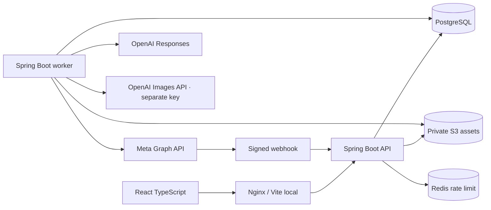
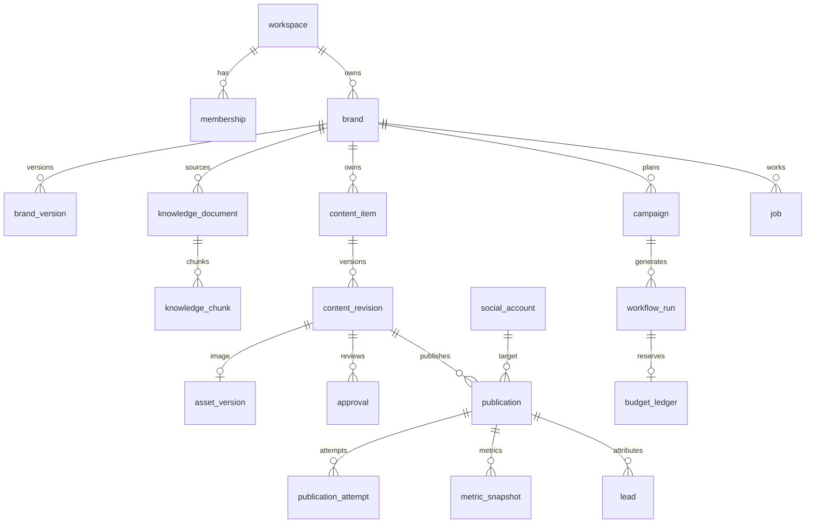

# Kiến trúc implementation

## Runtime

`APP_MODE=api` xử lý REST, session và webhook. `APP_MODE=worker` kích hoạt jobs, cadence campaign và outbox dispatcher. Cùng package nghiệp vụ/schema; module nằm trong `identity`, `brand`, `knowledge`, `workflow`, `content`, `ai`, `media`, `publishing`, `lead`, `operations`, `webhook`.

## Bất biến

- Workspace lấy từ membership người dùng đã đăng nhập; client không chọn workspace qua body. Brand scope và composite FK chặn tham chiếu chéo tenant.
- Revision body/hook/CTA/evidence/creative/hash/actor là bất biến bằng trigger DB. Chỉ status được đổi. Sửa tạo revision mới; bản cũ chưa duyệt được archive, bản đã duyệt giữ nguyên cho lịch đã chốt.
- Approval cần snapshot hash, policy version, actor còn quyền và hạn. Account cố định trên publication; nếu đổi đích phải tạo publication mới và kiểm tra gate.
- Publication snapshot chứa message, asset storage key/checksum và revision hash. Worker kiểm tra byte ảnh, nguồn, brand pause, quyền của người lập lịch/người duyệt và deadline trước dispatch.
- Internal intent và Idempotency-Key chống trùng trong DB. API chặn lịch mới cùng content/Page khi còn QUEUED, RETRY_WAIT, DISPATCHING hoặc UNKNOWN. Kết quả gửi mơ hồ không được gửi lại tự động.
- Job claim commit trước network call. Lease 120 giây, heartbeat 20 giây, fence tăng mỗi lần claim. Kết quả chỉ ghi khi lease/fence còn hợp lệ. DISPATCHING hết lease trở thành UNKNOWN.
- Ledger reserve theo brand/tháng, khóa brand trong transaction; settle ghi usage thật khi đủ metadata, hoặc giá ước tính. Campaign daily trigger khóa theo campaign/day và unique trigger_key.
- Contact chỉ được API có quyền trả về. Analyst thấy placeholder. Public form dùng brand key và publication tracking key ngẫu nhiên, consent time do server ghi.

## Dữ liệu chính

Migration V1 core, V2 media, V3 forms/tracking, V4 actor/four-eyes, V5 event projection, V6 campaign cadence, V7 ChatGPT registrations, V8 daily autopost config and run/publication version bindings. Timestamps nghiệp vụ dùng timestamptz; UI chuyển múi giờ thương hiệu. Tiền dùng bigint micro-USD.

## ADR

1. Modular monolith và hai runtime; PostgreSQL là nguồn sự thật cho lịch, approval và jobs.
2. Không broker ban đầu. Outbox có consumer operations receipt; không giả định external exactly-once.
3. Meta trực tiếp và ảnh đơn cho adapter đầu tiên. Không tự mặc định Graph version vì phải xác minh với app thật.
4. Content tạo thủ công cần human review. RULED trích nguồn demo giữ nguyên. Đăng tự động có grant riêng do Owner/Admin bật: actor autopost:<config>:<version> hợp lệ chỉ khi config đang bật, mode AUTO/DEMO, quyền còn hiệu lực, policy/hash khớp và không có risk flag; AUTO cần AI thật và consent. Yêu cầu người duyệt riêng hoặc risk flag luôn chờ reviewer.
5. Native local pilot là bổ sung sau khi Docker host filesystem lỗi. Production vẫn dùng DB/S3/Redis bên ngoài; filesystem và memory rate limiter từ chối chạy khi tắt demo.
6. Không download tài liệu qua URL trong MVP. URL là attribution metadata; việc fetch/research cần SSRF gate riêng trước khi bổ sung.

## ChatGPT plan connection

Kết nối local dùng OpenAI dynamic OAuth client + PKCE, callback gắn session và state dùng một lần. JWKS xác minh chữ ký ID token, issuer, audience, nonce và expiry trước khi lưu; scope quyết định có được dùng gói hay không. Credential ciphertext và identity/client mapping tách theo local member/workspace/registration, host ID bền vững theo cài đặt. PostgreSQL row lock serialize refresh token giữa API và worker.

Workflow cố định provider, connection ID và model lúc enqueue; foreign key gắn connection với chính creator/workspace. Worker dùng public Responses SSE với `store:false`, `stream:true` và chỉ nhận terminal `response.completed`, kiểm tra JSON và evidence như đường API key. Lỗi không fallback sang đường tính phí khác. ChatGPT usage ghi `CHATGPT_PLAN`, không dùng USD budget ledger để giả định còn hạn mức subscription.

## Daily autopost

Một config/thương hiệu liên kết campaign chuyên dụng (campaign cadence riêng tắt), Page cùng tenant, creator, image choice/key encrypted, giờ, consent và version. Scheduler chuẩn bị trong 30 phút trước slot tương lai theo brand timezone, brand/config lock và trigger unique chống trùng giữa worker. Enqueue cố định provider/model + config version; generation kiểm tra config lại sau network call trước ghi revision bất biến. Không lưu credentials trong run hoặc trả qua UI.

Preview không tạo publication. Normal daily run tự duyệt theo grant hoặc chờ người; approval của reviewer tự queue đúng slot nếu config còn hiệu lực. Publication chốt message/ảnh/checksum/actor/config version; preflight kiểm tra config enabled, target, consent, creator role cùng các gate hiện hữu. Stop/config save tăng version, cancel pending và kết thúc READY publish jobs; DISPATCHING/UNKNOWN giữ nguyên để đối soát. Mốc deadline là slot + 1 giờ, không dời slot đã lỡ sang ngày khác.

Images API riêng trả PNG 1024px, bounded body/deadline, không retry/fallback; lưu bytes gốc và provenance/hash trong revision. Budget reserve gồm chi phí text API dự trù (ChatGPT/DEMO không giữ USD text) cộng khoản ảnh; có ảnh thì settle ước tính bằng reserve, không tuyên bố chi phí đo thực.
